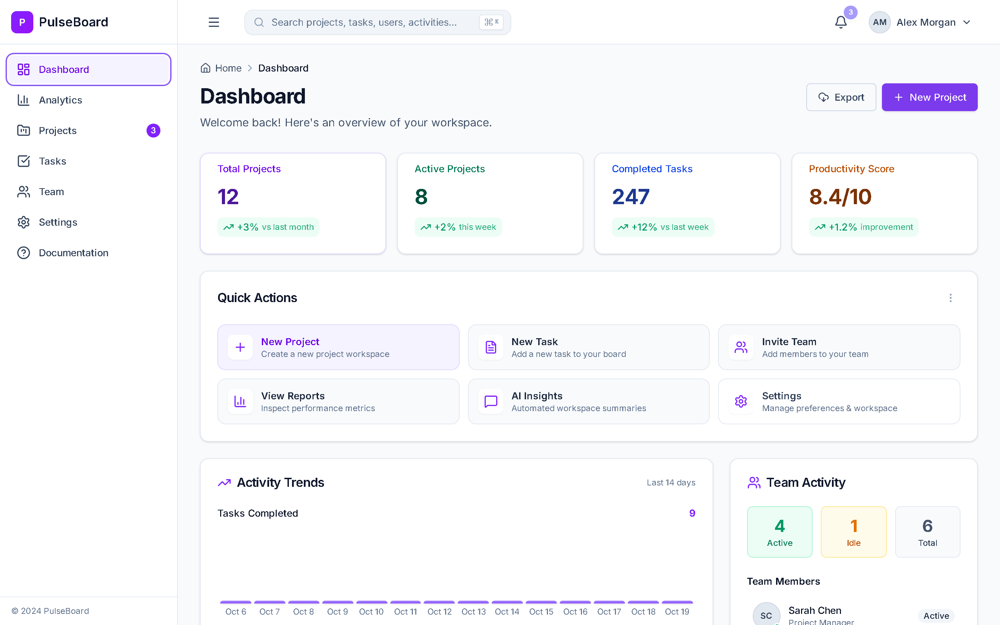
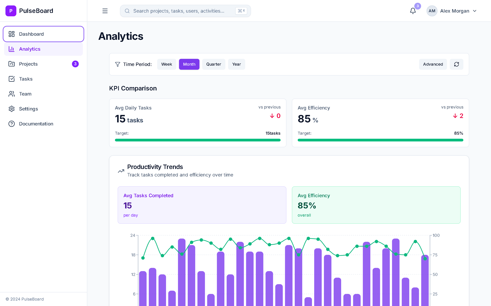
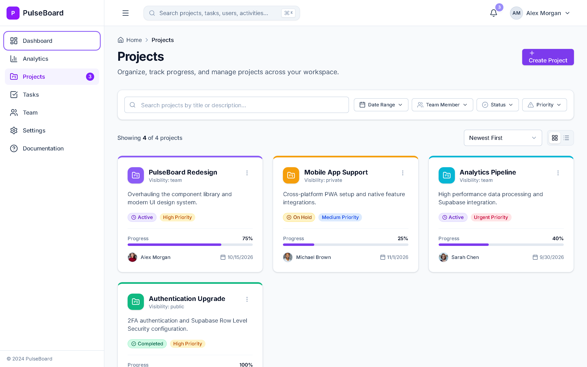
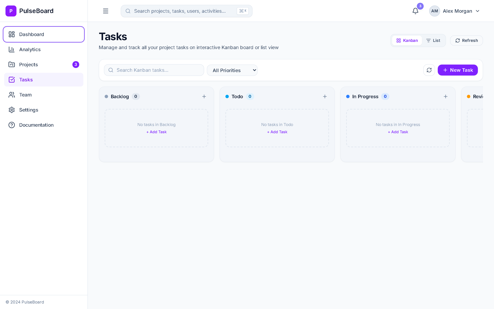
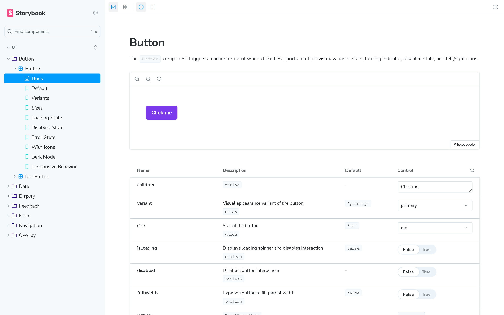
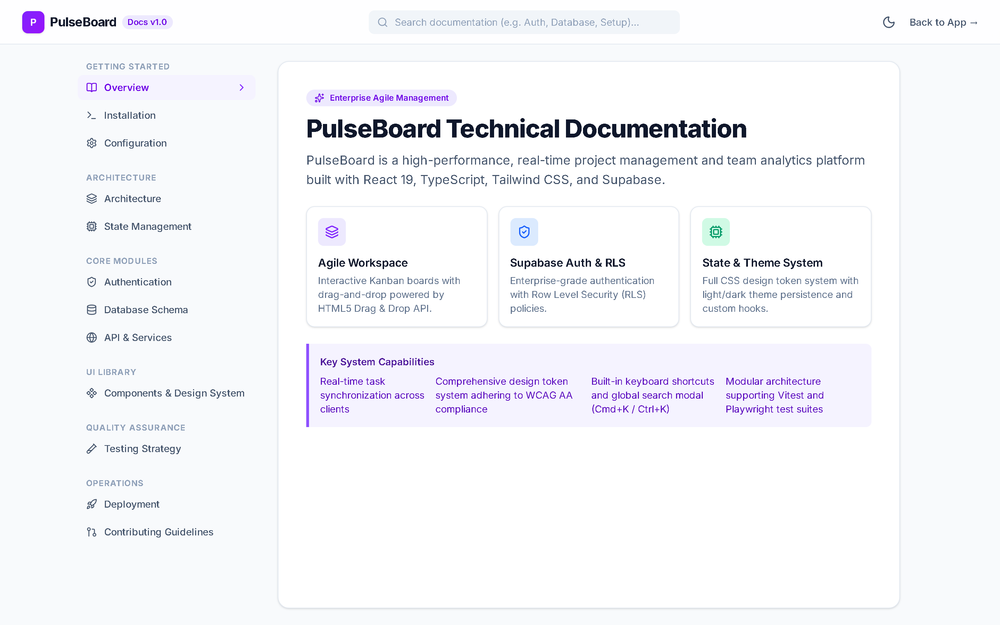

# PULSEBOARD

<div align="center">

<p align="center">
  <strong>A modern, enterprise-grade real-time dashboard and project management platform.</strong>
</p>

[](https://github.com/rskusalkar78/PULSEBOARD/actions/workflows/ci.yml)
[](https://pulseboard.vercel.app)
[](https://github.com/rskusalkar78/PULSEBOARD/actions/workflows/ci.yml)
[](package.json)
[](LICENSE)
[](CODE_OF_CONDUCT.md)

[Features](#-key-features) •
[Screenshots](#-screenshots) •
[Architecture](#-project-architecture) •
[Quick Start](#-getting-started) •
[Storybook](#-storybook-component-system) •
[Contributing](#-contributing) •
[Security](#-security-policy)

</div>

---

## 📸 Screenshots

### 1. Executive Dashboard

> High-level workspace overview featuring key metrics, productivity scores, activity velocity, quick actions, and real-time team presence.



### 2. Analytics & Productivity Trends

> Detailed productivity analytics with interactive charts, KPI comparison, efficiency rates, and custom timeframe filtering.



### 3. Project Management

> Multi-project portfolio management with progress tracking, priority labeling, team leads, and category filters.



### 4. Interactive Kanban Board

> Agile task management board powered by drag-and-drop workflows across Backlog, Todo, In Progress, Review, and Done.



### 5. Storybook Component Workbench

> Isolated UI component development environment with 26+ accessible, typed design components and a11y audit suite.



### 6. Technical Documentation Portal

> Built-in interactive developer and architecture documentation detailing APIs, database schemas, and theme design tokens.



---

## ✨ Key Features

- 🎨 **Unified Design Token System**: 150+ CSS variables power cohesive color palettes, elevations, and layout metrics.
- 🌓 **Zero-Flash Theme Engine**: Seamless switching between Light, Dark, and System modes with immediate persistence.
- ♿ **Accessible by Design**: All components follow WCAG AA contrast standards and WAI-ARIA keyboard navigation patterns.
- 📊 **Dynamic Visualizations**: Responsive data charts powered by Recharts with custom tooltips and gradient accents.
- 📋 **Agile Kanban Board**: Drag-and-drop task workflow with priorities, tag categorization, and dual List/Board view modes.
- 🔐 **Supabase & Local Resilience**: Full Supabase authentication with Row-Level Security (RLS) and automatic local mock fallback.
- 🧪 **Enterprise Test Suite**: Unit, integration, and E2E coverage across Vitest and Playwright.
- 🛠️ **Developer Experience**: TypeScript strict mode, path aliases (`@/*`), ESLint 9, Prettier, Husky, and lint-staged.

---

## 🚀 Tech Stack

| Domain              | Technology                                                                | Description                                               |
| :------------------ | :------------------------------------------------------------------------ | :-------------------------------------------------------- |
| **Framework**       | [React 19](https://react.dev/)                                            | Core UI rendering engine                                  |
| **Language**        | [TypeScript](https://www.typescriptlang.org/)                             | Strict type-safety across models and components           |
| **Build Tool**      | [Vite 6](https://vite.dev/)                                               | Instant HMR development and optimized production bundling |
| **Styling**         | [Tailwind CSS v4](https://tailwindcss.com/)                               | Modern utility-first styling with design token support    |
| **Icons**           | [Lucide React](https://lucide.dev/)                                       | Clean, consistent SVG icon set                            |
| **Charts**          | [Recharts](https://recharts.org/)                                         | Declarative charting library built on React and SVG       |
| **Drag & Drop**     | [@hello-pangea/dnd](https://github.com/hello-pangea/dnd)                  | Accessible drag-and-drop board management                 |
| **Form Management** | [React Hook Form](https://react-hook-form.com/) + [Zod](https://zod.dev/) | High-performance schema validation                        |
| **Backend & Auth**  | [Supabase](https://supabase.com/)                                         | PostgreSQL backend with Row-Level Security (RLS)          |
| **Testing**         | [Vitest](https://vitest.dev/) & [Playwright](https://playwright.dev/)     | Unit test runner and cross-browser E2E automation         |
| **Documentation**   | [Storybook 8](https://storybook.js.org/)                                  | Isolated component workbench and design system guide      |

---

## 📁 Project Architecture

```
PULSEBOARD/
├── .github/                  # GitHub workflows & community templates
│   ├── ISSUE_TEMPLATE/       # Bug report & feature request issue templates
│   ├── workflows/            # CI/CD pipeline automation (ci.yml)
│   └── pull_request_template.md # Standard PR checklist
├── docs/                     # Static media & repository documentation
│   └── screenshots/          # High-resolution application screenshots
├── e2e/                      # Playwright end-to-end test scenarios
├── src/
│   ├── app/                  # Application shell, router, and root providers
│   ├── assets/               # Static media and icons
│   ├── components/           # Reusable UI component library (Button, Dialog, etc.)
│   ├── constants/            # Application constants and configuration
│   ├── contexts/             # Global React state contexts (Auth, Task, Toast)
│   ├── features/             # Feature domain modules
│   ├── hooks/                # Custom React lifecycle and data hooks
│   ├── layouts/              # AppLayout, DashboardLayout, and AuthLayout
│   ├── lib/                  # Third-party client initializations (Supabase)
│   ├── pages/                # Route page implementations
│   ├── schemas/              # Zod schema definitions
│   ├── services/             # Supabase & mock API service layer
│   ├── styles/               # Design tokens and global CSS
│   ├── types/                # TypeScript interface and type declarations
│   └── utils/                # Helper functions and utilities
├── supabase/                 # Supabase database schema and RLS migrations
├── .storybook/               # Storybook configuration & preview settings
├── CHANGELOG.md              # Historical version release log
├── CODE_OF_CONDUCT.md        # Community guidelines (Contributor Covenant 2.1)
├── CONTRIBUTING.md           # Contribution and local setup guidelines
├── LICENSE                   # Open-source MIT License
├── package.json              # Dependencies and project scripts
├── README.md                 # Primary repository documentation
├── SECURITY.md               # Responsible vulnerability disclosure policy
└── vite.config.ts            # Vite build configuration and aliases
```

---

## 🚦 Getting Started

### Prerequisites

- **Node.js**: `>= 20.0.0` (LTS recommended)
- **npm**: `>= 10.0.0`

### Installation

1. Clone the repository:

   ```bash
   git clone https://github.com/rskusalkar78/PULSEBOARD.git
   cd PULSEBOARD
   ```

2. Install dependencies:

   ```bash
   npm install
   ```

3. Setup environment variables:

   ```bash
   cp .env.example .env
   ```

   _(PulseBoard runs out of the box with offline mock services if Supabase credentials are left as placeholders)._

4. Launch the development server:
   ```bash
   npm run dev
   ```
   Open [http://localhost:5173](http://localhost:5173) in your browser.

---

## 🧪 Testing & Quality Assurance

PulseBoard maintains rigorous testing standards across unit, component, integration, and end-to-end levels:

```bash
# Run unit and integration tests
npm run test

# Run tests with code coverage analysis
npm run test:coverage

# Run Playwright end-to-end tests
npm run test:e2e

# Run TypeScript typecheck
npm run typecheck

# Run ESLint checks
npm run lint

# Validate Prettier formatting
npm run format:check
```

---

## 📚 Storybook Component System

Explore and test UI components in isolation with interactive state controls:

```bash
# Start local Storybook development server
npm run storybook
```

Open [http://localhost:6006](http://localhost:6006) to browse interactive documentation for all 26+ UI primitives.

To generate a static build of the Storybook:

```bash
npm run build-storybook
```

---

## 🤝 Contributing

Contributions are welcome and appreciated! Please read our [Contributing Guidelines](CONTRIBUTING.md) to learn how to propose bug fixes, features, and pull requests.

Please review our [Code of Conduct](CODE_OF_CONDUCT.md) before participating in discussions.

---

## 🔒 Security Policy

For vulnerability reporting procedures and disclosure timelines, please see our [Security Policy](SECURITY.md). Please do **not** report security vulnerabilities via public GitHub issues.

---

## 📄 License

This project is open source and available under the [MIT License](LICENSE).  
Copyright (c) 2026 Rohan Shankar Kusalkar.
